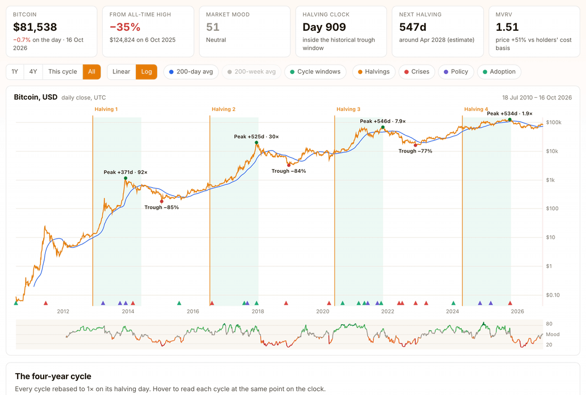

<div align="center">

# Bitcoin Cycle

**Bitcoin daily since July 2010, with a fear/greed gauge, the halving clock, and a backtest of whether either one pays.**

[**fang89.github.io/Bitcoin-Cycle →**](https://fang89.github.io/Bitcoin-Cycle/)

<br>

<a href="https://fang89.github.io/Bitcoin-Cycle/"><picture><source media="(prefers-color-scheme: dark)" srcset="docs/screenshots/btc-demo-dark.gif"></picture></a>

</div>

---

## The pitch

Everyone in crypto has an opinion on the four-year cycle. Hardly anyone shows the base rates. This
does two things:

1. **It ports the mood index from the [Singapore STI dashboard](https://github.com/fang89/Singapore-STI)**
   to bitcoin, using the same build, the same 3-year ranking and the same bands, and checks whether
   it means the same thing here. It doesn't, quite.
2. **It puts the halving clock on the chart.** Each cycle is rebased to its halving day so you can
   read them side by side. Then the cycle is tested the way you'd test any timing signal: as a
   pre-registered rule, against a placebo, and out of sample.

## The verdict

- **The cycle held, four for four.** Peaks came **371, 525, 546 and 534 days** after the halving.
  Completed bear markets fell **−85%, −84%, −77%** and bottomed **364–406 days** after the peak.
- **The clock alone beat buy-and-hold.** Long for 18 months from each halving, cash otherwise:
  about **100% CAGR vs 88%**, holding coins 43% of the time. Long from 12 months *before* the
  halving: **129%**. The 12-months-before version beat buy-and-hold in all four cycles. The edge comes from dodging years
  2–3, not from avoiding crashes: max drawdown was still −71%.
- **But the runs are shrinking fast.** Halving to peak went **92× → 30× → 8× → 2×**. Timings fitted
  on 2012 and 2016 called the 2020 and 2024 peaks about **three months early** both times.
- **Fear is a buy, greed is not a sell.** Extreme fear was higher a year later in **5 of 5 years**.
  Extreme greed came before the **biggest** forward returns (median +263% over 12 months), because in
  bitcoin greed is momentum. "Buy fear, sell greed" made **19% a year**, the worst rule tested.
- **Read the mood through the clock.** Fear in the first 18 months after a halving usually meant
  the top was in (median −38% a year later). Fear after month 30 was higher a year later every time.

**Where we are (16 Oct 2026):**

- It is day 909 of the 2024 cycle. The price is **35% below** the October 2025 peak, and the low so
  far is −53% (30 Jun 2026).
- Today sits inside the window where past cycles bottomed: 5 Oct to 16 Nov 2026.
- Mood is 51 (neutral). The next halving is about April 2028.

## What's on the screen

- **Price chart.**
  - Log or linear scale, with the 200-day and 200-week averages.
  - Every halving is marked, with a dashed line at the estimated 2028 halving.
  - Each cycle's peak and trough are labelled, and the 18-month post-halving windows are shaded.
  - A red band marks where past bear markets bottomed, timed from this cycle's peak.
  - 31 curated events: Mt. Gox, the China bans, COVID, Terra, FTX, spot ETFs and more.
  - Hover any day for its mood and its position on the halving clock.
- **Cycle overlay.** The four cycles rebased to 1× on halving day. Hover to read each one at the
  same day count.
- **Mood panel.** Today's score and its five components, plus the forward returns behind each band.
  The same bands are also split by cycle phase.
- **Rule backtests.** Growth of $1 for six rules, with CAGR, max drawdown and per-cycle returns.
  Everything is computed in the browser from `data.js`, so it updates with the data.

## Market mood: how it's built

Same recipe as the STI version. Code: [`indicators.js`](indicators.js). Full note with every test
table: [METHODOLOGY.md](METHODOLOGY.md).

| Input | Calc on day *t* | Risk-on when |
|---|---|---|
| **Trend** | price ÷ 200-day SMA − 1 | high |
| **Valuation** | MVRV: market cap ÷ realised cap | high |
| **Network** | 30-day avg active addresses ÷ 365-day avg − 1 | high |
| **Drawdown** | price ÷ 365-day high − 1 | near 0 |
| **Calm** | 30-day realised vol, annualised | low |

1. Rank each input against its own trailing **3 years**, needing at least one year of data. Calm
   is inverted so that 1.0 always means risk-on.
2. Average the ranks with equal weights, needing at least 3 of 5, and scale to 0–100.
3. Bands: **0–20** extreme fear · **20–40** fear · **40–60** neutral · **60–80** greed ·
   **80–100** extreme greed.

The swap from the STI: breadth and new highs/lows need 30 member stocks, so on-chain valuation
(MVRV) and network activity take their slots. All windows are in calendar days, because bitcoin
never closes. Nothing was tuned on bitcoin.

## Caveats

- **N = 4.** Three completed cycles and one open one. A placebo test shows the halving dates are the
  best-performing phase of a four-year clock, but with four data points some phase had to be.
- **The theory is public.** Anything this well known gets front-run, which is one reading of why
  the peaks keep arriving later than the early cycles implied.
- **Early-era distortion.** The 2012–13 run (92×) inflates every full-sample average. Post-2017
  splits are in the methodology.
- **Frictionless.** No fees, no taxes, and cash earns 0%.
- **Not investment advice.** These are base rates for sizing and expectations.

Every number above is reproduced by `python3 tools/backtest.py` (needs pandas and numpy).

## Data and plumbing

Daily price, MVRV and active addresses come from the free
[Coin Metrics community API](https://docs.coinmetrics.io/api/v4/), going back to July 2010. That
reaches past Yahoo's `BTC-USD`, which starts in 2014 and misses the first halving. There's no build
step: static HTML, a canvas chart and one data file.

```bash
python3 -m http.server     # → http://localhost:8000
python3 fetch_data.py      # refresh data.js (no key, no pip installs)
```

| File | Role |
|---|---|
| `index.html` | Page, styles, theme toggle, script loader |
| `app.js` | Charts, events, panels, rule tables |
| `indicators.js` | Mood, halving clock, cycle anatomy, rule backtests (no rendering) |
| `data.js` | Generated data |
| `fetch_data.py` | Data refresh |
| `tools/backtest.py` | Reproduces every table in METHODOLOGY.md |
| `METHODOLOGY.md` | The full research note |

Events are hand-curated in the `EVENTS` array at the top of `app.js`.

MIT licence.
